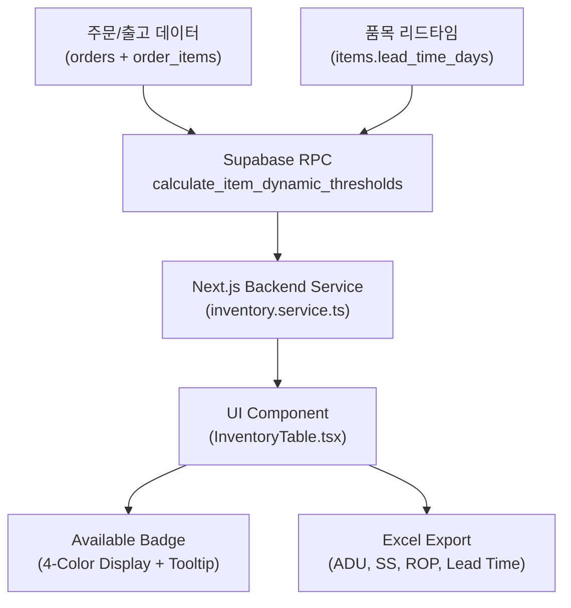

# ⚡ WMS 동적 재고 임계치(Dynamic Stock Thresholds) 산출 아키텍처 및 운영 가이드

본 문서는 WMS 시스템에서 품목의 **실시간 재고 소진율(Daily Outbound Velocity)**과 **공급사 리드타임(Supplier Lead Time)**을 바탕으로 가용재고(Available)의 상태 임계치를 수학적·통계적으로 자동 산출하는 체계 및 운영 가이드를 정리한 기술 문서입니다.

---

## 1. 도입 배경 및 목표

* **기존 방식의 한계 (고정 임계치)**:
  - 전 품목에 일괄적인 숫자(예: 10개 이하 = 경고)를 적용하면, 하루에 50개씩 나가는 **고회전(Fast-Moving) 품목은 10개가 남아 있어도 즉시 품절 위험**에 노출됩니다.
  - 반대로 한 달에 2~3개만 나가는 **저회전(Slow-Moving) 품목은 5개만 있어도 충분한데 불필요한 결품 경고**가 떠서 과다 발주 및 창고 적체를 유발합니다.
* **동적 임계치(Self-Adaptive) 목표**:
  - 관리자가 일일이 수작업으로 수정하지 않아도, 최근 실제 출고 소비 속도와 공급처 납기 시간을 감지하여 **각 품목별 최적의 안전재고(Safety Stock)와 재주문점(Reorder Point)을 매일 실시간 자동 산출**합니다.

---

## 2. 핵심 지표 및 변수 정의

시스템은 최근 30일간 실제 출고 확정된 주문(`order_items`)과 품목 마스터(`items`) 테이블에서 다음 4대 변수를 자동으로 추출합니다:

| 지표명 | 기호 | 소스 컬럼 / 산출 방식 | 기본값 / 단위 |
| :--- | :---: | :--- | :--- |
| **일평균 소진량** | $ADU$ | 최근 30일 총 출고 수량 $\div$ 분석 기간 일수 | `units / day` |
| **출고 변동성** | $\sigma_D$ | 일별 출고 수량의 표본 표준편차 (`STDDEV_SAMP`) | `deviation` |
| **공급 리드타임** | $L$ | 발주 후 입고까지 소요 영업일수 (`items.lead_time_days`) | `7 days` |
| **목표 서비스 수준** | $Z$ | 결품 방지 통계 계수 (`items.target_service_level` = 95% 신뢰도) | `1.65 ~ 1.73` |
| **유통기한 일수** | $SL$ | 식품/신선류의 안전 유효일수 (`items.shelf_life_days`) | `days (선택)` |

---

## 3. 통계적 자동 산출 공식 (Statistical Algorithm)

```
        0                      Safety Stock (SS)             Reorder Point (ROP)             Surplus Point
        |------------------------------|------------------------------|----------------------------|------------->
 [🔴 Out of Stock]           [🟠 Low / Alert]               [🟢 Optimal Stock]              [🔵 Surplus]
  (즉시 결품 상태)           (리드타임 내 품절 위험)          (원활한 주문 대응 구간)           (과다 재고/체증 구간)
```

### ① 최소 안전재고 (Low Threshold = Safety Stock, $SS$)
발주 후 물품이 도착하기까지 급작스러운 주문 폭증(수요 변동성)을 흡수하는 최소 버퍼 수량:
$$SS = \max\left(1, \left\lceil Z \times \sigma_D \times \sqrt{L} \right\rceil\right)$$
* *출고 이력이 없는 신규 품목의 경우*: 마스터에 등록된 `min_stock_qty` (기본값: 10)를 안전하게 대체 채택.

### ② 재주문점 (Optimal Lower Threshold = Reorder Point, $ROP$)
지금 발주를 진행하지 않으면 공급 리드타임 동안 재고가 소진되어 안전재고를 갉아먹게 되는 위험 경계선:
$$ROP = \lceil (ADU \times L) + SS \rceil$$
* 가용재고가 $ROP$ 이하로 떨어지면 출고 지연을 방지하기 위해 **즉각 발주(PO) 생성** 필요.

### ③ 적정 재고 상한 및 잉여점 (Surplus Point, $Optimal_{Max}$)
정기 검토 주기(Review Period, 기본 14일) 동안 소진 가능한 수량을 더하되, **유통기한 폐기 손실을 막기 위한 캡(Shelf-life Cap)**을 적용:
$$Surplus = \min\Big(\text{Shelf-life Cap}, \; ROP + (ADU \times 14)\Big)$$
$$\text{단, Shelf-life Cap} = \lceil ADU \times SL \times 0.70 \rceil \quad (\text{유통기한의 70\% 이내 소비 가능량})$$

---

## 4. 4단계 가용재고(Available) 상태 및 시각화 매트릭스

사용자의 요청에 따라 텍스트 없이 **깔끔한 단일 수치 뱃지**로 표시되며, 재고 상태에 따라 4단계 Tailwind 컬러가 부여됩니다:

| 상태 | 판정 조건 | 뱃지 시각 스타일 | 비즈니스 조치 |
| :--- | :--- | :--- | :--- |
| **품절 (Stockout)** | `Available <= 0` | 🔴 **Rose / Red** (`bg-rose-500/15 text-rose-700 border-rose-500/30 font-semibold`) | 출고 불가 / 긴급 발주 및 대체 출고 검토 |
| **재고 부족 (Low)** | `0 < Available <= SS` | 🟠 **Amber / Orange** (`bg-amber-500/15 text-amber-700 border-amber-500/30 font-semibold`) | 안전재고 미달 / 재발주(PO) 대기열 큐 진입 |
| **적정 재고 (Optimal)** | `SS < Available <= ROP` | 🟢 **Emerald / Green** (`bg-emerald-500/15 text-emerald-700 border-emerald-500/30 font-semibold`) | 안정적 출고 대응 가능 구간 |
| **충분/여유 (Surplus)** | `Available > ROP` | 🔵 **Sky / Blue** (`bg-sky-500/15 text-sky-700 border-sky-500/30 font-semibold`) | 충분한 여유 재고 보유 |

---

## 5. 시스템 아키텍처 및 구현 파일 맵



### 관련 구현 파일
1. **DB 마이그레이션**:
   - `supabase/migrations/20261024130000_add_lead_time_and_dynamic_stock_thresholds.sql`: 리드타임 컬럼 및 RPC 생성
   - `supabase/migrations/20261024130500_update_dynamic_thresholds_rpc.sql`: 주문 상태 enum 정합성 동기화
2. **백엔드 서비스**:
   - `web-app/src/services/inventory.service.ts`:
     - `getItemDynamicThresholdsMap()`: 품목별 동적 임계치 맵 병렬 페치
     - `getInventoryList()`: 각 인벤토리 행에 `dynamicThreshold` 주입
3. **프론트엔드 UI**:
   - `web-app/src/components/features/inventory/InventoryTable.tsx`:
     - ⚡ **Auto-Tuned Mode** vs ⚙️ **Manual Mode** 듀얼 토글 지원
     - `getAvailableBadge()`: 마우스 호버 시 실시간 계산 내역 툴팁 표기
     - 하단 실시간 상태 인디케이터(범례) 연동

---

## 6. 사용자 화면 운영 가이드

### 1) ⚡ Auto-Tuned 모드 (기본 권장)
* **특징**: 테이블의 모든 SKU가 각자의 소비 속도와 리드타임에 맞춰 독립적으로 색상이 결정됩니다.
* **툴팁 확인**: 
  - Available 컬럼의 숫자에 마우스를 올리면 다음과 같은 산출 근거 툴팁이 팝업됩니다:
    ```text
    [Auto-Tuned by Velocity]
    • Daily Burn (ADU): 0.17 /day
    • Supplier Lead Time: 7 days
    • Safety Stock (Low): 3
    • Reorder Point (Optimal): 5
    ```

### 2) ⚙️ Manual 모드 (수동 고정값)
* **전환 방법**:
  1. 테이블 상단 우측 `Download Excel` 좌측의 **`[⚡ Thresholds AUTO]`** 버튼 클릭
  2. 팝오버 상단에서 **`[⚙️ Manual]`** 선택
  3. `Low Stock Threshold`와 `Optimal Stock Threshold`에 원하는 고정 수치 입력 후 **`Apply`** 클릭
* **저장**: 브라우저의 `localStorage`에 저장되어 새로고침 후에도 유지됩니다.

### 3) 개별 품목의 안전재고/리드타임 직접 수정
* **경로**: 좌측 메뉴의 **[Master > Items]**
* **방법**: 해당 품목의 `Edit` 버튼 클릭 $\rightarrow$ `Settings & Details` 탭 $\rightarrow$ `Min Stock Qty` 수정
* 출고 이력이 없는 신품목의 경우 등록된 `Min Stock Qty`를 기본 안전재고로 자동 인식합니다.
