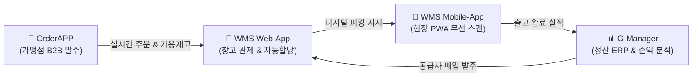

# 🌐 All-in-One SCM/WMS B2B SaaS 상품화 마스터 플랜 (Master Plan)
> **대상 시스템 생태계**: `OrderAPP (B2B 발주)` + `WMS Web-App (물류 관제)` + `WMS Mobile-App (현장 PDA)` + `G-Manager (ERP/손익)`  
> **문서 버전**: v1.0.0  
> **최종 갱신일**: 2026-11-01  
> **문서 목적**: 글라이프(Glife) 전용으로 구축된 4개 시스템을 동종 식자재 유통, 프랜차이즈 본사, 3PL 물류 기업 대상의 **구독형 B2B Multi-Tenant SaaS 플랫폼**으로 전환하기 위한 엔드투엔드 마스터 플랜

---

## 1. 개요 및 비즈니스 비전 (Executive Vision)

### 1.1 시장 기회 및 독보적 경쟁 우위
중소/중견 식자재 유통사, 프랜차이즈 가맹 본부, 중소형 3PL 물류사는 대기업용 고가 ERP(SAP, 오라클)를 도입하기 어렵고, 시중의 단순 솔루션들은 **물류(WMS)와 발주(OrderApp), 회계(ERP)가 제각각 분절**되어 있어 여전히 엑셀과 수기 카카오톡 주문에 의존하고 있습니다.

현재 구축된 4개 시스템은 물류의 전 과정을 실시간으로 관통하는 **국내/글로벌 유일무이한 "All-in-One 식자재 풀스택 SCM"**입니다:
* **발주처(가맹점)**: 모바일 전용 B2B OrderAPP을 통해 실시간 가용재고를 확인하고 즉시 발주
* **물류센터(WMS Web)**: 주문 인입 즉시 자동 소프트 할당, 2D 랙 관제, FEFO 유통기한 관리, 번들 해체(De-kitting) 자동화
* **현장 작업자(WMS Mobile)**: 대당 수백만 원짜리 전용 PDA 대신 개인 스마트폰/PWA를 통해 초고속 무선 바코드 적치/피킹
* **경영진(G-Manager)**: 매입/매출 인보이스, 공급사 발주, 실시간 마진 및 미수금 관리



---

## 2. 단일 기업 구조 $\rightarrow$ 멀티테넌트(Multi-Tenant) SaaS 전환 아키텍처

### 2.1 아키텍처 토폴로지 (SaaS Topology)

```
[ B2B 고객사 도메인 분기 ]
acme.scm-saas.com (A사 창고)     ──┐
fresh.scm-saas.com (B사 유통)    ──┼──> [ Next.js Middleware ] ──> [ Tenant Context 주입 ]
glife.scm-saas.com (Glife)       ──┘         (도메인 기반 테넌트 식별)          (tenant_id)
                                                                           │
                                                                           ▼
                                                                [ Supabase Postgres ]
                                                                (Row-Level Security)
                                                                tenant_id 기준 데이터 100% 원천 격리
```

### 2.2 핵심 데이터 모델 설계 (Tenant Isolation Schema)

```sql
-- 1. 테넌트 (구독 기업) 마스터
CREATE TABLE public.tenants (
    id UUID PRIMARY KEY DEFAULT gen_random_uuid(),
    code VARCHAR(50) UNIQUE NOT NULL,           -- e.g. 'acme', 'glife'
    company_name VARCHAR(100) NOT NULL,
    business_number VARCHAR(50),
    custom_domain VARCHAR(100) UNIQUE,          -- e.g. 'wms.acmefood.com'
    subscription_plan VARCHAR(30) DEFAULT 'STARTER', -- STARTER, PRO, ENTERPRISE
    subscription_status VARCHAR(30) DEFAULT 'ACTIVE',-- ACTIVE, PAST_DUE, CANCELED
    created_at TIMESTAMPTZ DEFAULT NOW(),
    updated_at TIMESTAMPTZ DEFAULT NOW()
);

-- 2. 테넌트별 브랜딩 및 룰 설정
CREATE TABLE public.tenant_settings (
    tenant_id UUID PRIMARY KEY REFERENCES public.tenants(id) ON DELETE CASCADE,
    logo_url TEXT,
    primary_color VARCHAR(20) DEFAULT '#059669',
    currency VARCHAR(10) DEFAULT 'KRW',
    timezone VARCHAR(50) DEFAULT 'Asia/Seoul',
    stock_policy VARCHAR(30) DEFAULT 'HARD_LIMIT', -- HARD_LIMIT, BACKORDER
    perishable_mode BOOLEAN DEFAULT TRUE,          -- FEFO 선석출 여부
    auto_dekit_enabled BOOLEAN DEFAULT TRUE,       -- 멀티팩 자동 해체 활성화
    location_format VARCHAR(100) DEFAULT 'LOC-{ZONE}{AISLE:02}{RACK:02}{LEVEL}{BIN:02}',
    updated_at TIMESTAMPTZ DEFAULT NOW()
);

-- 3. 모든 비즈니스 테이블에 tenant_id 강제 및 RLS 적용
-- items, inventory, locations, orders, order_items, partners, users ...
ALTER TABLE public.items ADD COLUMN tenant_id UUID REFERENCES public.tenants(id);
ALTER TABLE public.inventory ADD COLUMN tenant_id UUID REFERENCES public.tenants(id);
ALTER TABLE public.orders ADD COLUMN tenant_id UUID REFERENCES public.tenants(id);

-- Supabase RLS 정책 (데이터 원천 격리)
ALTER TABLE public.inventory ENABLE ROW LEVEL SECURITY;
CREATE POLICY "Tenant Isolation on Inventory" ON public.inventory
FOR ALL USING (
    tenant_id = (auth.jwt() ->> 'tenant_id')::UUID
    OR (auth.jwt() ->> 'role') = 'service_role'
);
```

---

## 3. 4대 시스템별 High-Quality 엔터프라이즈 고도화 상세 규격

외부 기업들이 대기업 수준의 완성도를 느끼고 주저 없이 구독할 수 있도록 만드는 시스템별 킬러 피처입니다:

### 3.1 🏢 WMS Web-App (물류 본부 통합 관제)
1. **2D 비주얼 창고 스튜디오 (Drag & Drop Warehouse Builder)**:
   * 복잡한 DB 설정 없이 마우스 드래그로 벽면, 출입문, 랙 통로, 단수(1~5단), 상온/냉장/냉동 구역을 자유롭게 배치하는 인터랙티브 캔버스.
   * `[빌드 완료]` 버튼 클릭 시 수백 개의 로케이션 코드와 2단 바코드 라벨 PDF가 일괄 자동 생성.
2. **동적 파동 출고 (Wave & Batch Picking Planning Engine)**:
   * 100건의 주문이 인입되었을 때, 작업자 1명이 1건씩 100번 왕복하는 비효율 제거.
   * "오전 냉동 품목 묶음 피킹", "서울 남부권 배송 차량별 묶음 피킹" 등 동선을 60% 이상 절감하는 최적 배치 생성.
3. **공급사 사전 입고 통지(ASN) 및 무선 입고 검수**:
   * 식품 제조사가 납품 전 송장(품목, 수량, 유통기한)을 사전 등록. 입고장에서 바코드 스캔 한 번으로 발주서 대비 과입고/오입고/파손을 즉시 감지하여 차이분 자동 전표 발행.
4. **3PL 정산 엔진 (3PL Storage & Handling Billing)**:
   * 타사 화물을 보관해 주는 3PL 기업을 위한 일일 파렛트/CBM당 보관료, 입출고 핸들링 피, 유통기한 초과 할증료 자동 계산 및 매월 인보이스 원클릭 청구.

---

### 3.2 📱 WMS Mobile-App (현장 작업자 PDA)
1. **오프라인 우선 (Offline-First) 동기화 아키텍처**:
   * 대형 냉동창고, 샌드위치 패널 내부는 Wi-Fi 음영 구역이 빈번함.
   * IndexedDB 로컬 캐싱을 탑재하여 **Wi-Fi가 완전히 끊겨도 바코드 스캔, 적치, 피킹이 100% 정상 작동**하며, 통신이 복구되면 백그라운드 자동 큐 동기화.
2. **최적 피킹 동선 네비게이션 (TSP Pick-Path Navigation)**:
   * 피커가 랙 사이를 지그재그로 방황하지 않도록, 창고 진입부터 출구까지 **"최단 1-Way 피킹 경로"**를 화면에 실시간 화살표와 순번으로 지시.
3. **다중 오더 카트 피킹 (Multi-Order Cart Picking)**:
   * 피킹 대차에 바구니 4~8개를 싣고, 1번 상품 스캔 시 **"바구니 A(강남점)에 2개, 바구니 B(서초점)에 3개 분배"**를 시각적으로 지시(Pick-to-Tote).
4. **산업용 PDA 레이저 스캐너 SDK 네이티브 지원**:
   * Zebra DataWedge, Honeywell, PointMobile 등 현장 전용 하드웨어 스캐너의 레이저 인텐트를 초당 3회 이상 노딜레이로 수신.

---

### 3.3 🛒 OrderAPP (B2B 가맹점 / 바이어 발주 포털)
1. **거래처별 차등 단가 및 여신(Credit Limit) 한도 통제**:
   * 직영점 단가, 일반 가맹점 단가, 대형 도매처 단가를 등급별로 자동 계산.
   * 미수금이 한도(예: 300만원)를 초과하거나 어음 만기가 지난 가맹점은 발주 버튼이 자동 잠금 처리되는 채권 보호 엔진.
2. **배송 권역별 발주 마감 시간(Cut-off) & MOQ 타이머**:
   * "새벽배송: 전일 오후 6시 마감", "주간배송: 당일 오전 10시 마감" 타이머가 실시간 카운트다운되며 마감 시간 초과 시 다음 배송일로 자동 이월.
3. **간편 정기 발주 템플릿 & 지난주 재주문**:
   * 매주 시키는 기본 식자재 세트를 원클릭 장바구니에 담기, 지난주 주문서 복사 발주 기능.
4. **사진 첨부 모바일 반품/클레임 센터**:
   * 파손/오배송 상품을 휴대폰 카메라로 즉시 촬영하여 접수 $\rightarrow$ WMS 관리자 승인 시 다음 인보이스에서 마이너스 차감 정산.

---

### 3.4 📊 G-Manager (통합 ERP / 손익 / 세일즈 분석)
1. **실시간 매출원가(COGS) & 순마진(Net Margin) 분석**:
   * 매주 변동하는 농수산/식자재 매입단가에 맞춰, 실제 출고된 배치의 매입원가를 이동평균법/개별법으로 매칭하여 **품목별, 매장별 진짜 순이익(%)**을 실시간 산출.
2. **전자세금계산서 및 국세청 홈택스 자동 연동**:
   * 인보이스 확정 시 국세청 전자세금계산서(팝빌/바로빌 연동) 원클릭 대량 발행.
3. **공급사 위탁 재고 포털 (Vendor VMI Portal)**:
   * 주요 식품 제조사/납품업체가 로그인하여 우리 창고에 있는 자기네 상품의 실시간 재고와 소진 속도를 모니터링하고 추가 입고를 자율 계획.

---

## 4. 구독 비즈니스 모델 및 가격 정책 (Pricing Strategy)

식자재 유통 및 3PL 시장의 지불 용의에 맞춘 3단계 티어 요금제와 종량제 구조입니다:

| 구분 | **Starter (소형 도매/단일창고)** | **Professional (성장형 프랜차이즈)** | **Enterprise (대형 유통 / 3PL)** |
| :--- | :--- | :--- | :--- |
| **월 구독료** | **월 19만 ~ 29만원** ($199) | **월 49만 ~ 69만원** ($499) | **월 120만원 ~ 250만원** ($999+) |
| **창고 수** | 1개 | 2~3개 | 다중 창고 (무제한) |
| **관리 품목(SKU)** | 최대 500개 | 최대 3,000개 | 무제한 |
| **작업자 계정(PDA)**| 3명 | 10명 | 무제한 |
| **발주처(OrderAPP)** | 가맹점 30곳 | 가맹점 100곳 | 무제한 |
| **핵심 기능** | 기본 입출고, 발주, 라벨 인쇄 | **번들 해체(De-kit)**, FEFO, 카카오 알림, 동적 임계치 | 2D 맵 빌더, 3PL 보관료 정산, 오프라인 PDA, 외부 ERP API |
| **추가 과금 (Add-on)**| 작업자 추가: 월 2만원/인 | 발주 가맹점 추가: 월 2천원/점 | 카카오톡/SMS: 건당 실비 과금 (15원/건) |

---

## 5. 단계별 마이그레이션 실행 로드맵 (Execution Roadmap)

```
[ Phase 1: 기반 정비 (4주) ]
  • 코드베이스 내 Glife 하드코딩(이메일, ID, 브랜딩) 100% 제거
  • tenant_id 기반 DB 스키마 분리 및 Supabase RLS 완벽 격리
  • 번들 해체(De-kitting) 관리자 GUI 설정화 (라면 외 음료/공산품 확장)

[ Phase 2: High-Quality UX 고도화 (6주) ]
  • WMS 2D 비주얼 창고 맵 드래그 앤 드롭 빌더 구축
  • 모바일 앱 Offline-First(IndexedDB) 및 산업용 스캐너 SDK 탑재
  • OrderAPP 거래처별 등급 단가 및 여신 한도 통제 모듈 개발

[ Phase 3: SaaS 빌링 & 셀프 온보딩 (4주) ]
  • 토스페이먼츠 / Stripe 정기 결제 및 구독 라이선스 엔진 연동
  • 30분 엑셀 마스터 마이그레이션 및 자동 셋업 위저드 완성
  • 가맹점/창고 온보딩 동영상 가이드 및 헬프센터 구축

[ Phase 4: 파일럿 런칭 & GTM (6주) ]
  • 글라이프 협력사 및 유사 식자재 납품업체 3곳 대상 50% 할인 파일럿 런칭
  • 현장 피드백 수렴 및 안정화 후 정식 B2B 마케팅/영업 개시
```

---

## 6. 결론 및 기대 성과

현재 구축된 시스템은 단순한 코드가 아니라, **실제 물류 현장에서 발생하는 예외 상황(번들 해체, 낱개-박스 환산, FEFO 유통기한, 무선 바코드 피킹, 카카오톡 실시간 보고)을 모두 해결해 낸 검증된 자산**입니다.

본 마스터 플랜에 따라 **"멀티테넌시 RLS 격리"**, **"오프라인 PDA 내구성"**, **"가맹점 단가/여신 관리"**를 순차적으로 고도화하면, 글라이프의 자체 운영 효율을 극대화할 뿐만 아니라 **연간 수억 원 이상의 반복 매출(ARR)을 창출하는 독보적인 B2B SCM SaaS 테크 기업**으로 도약할 수 있습니다.
