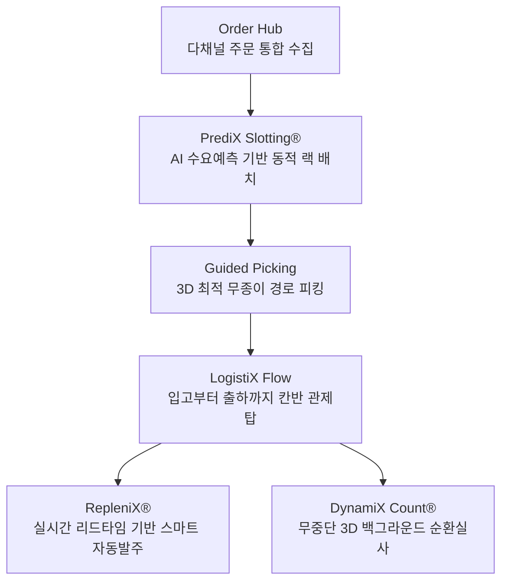
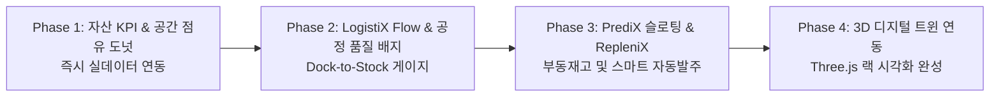

# 차세대 WMS 관제 대시보드 고도화 상세 설계서 (Dashboard Enhancement Specification)
## 3DLogistiX 데이터 기반 재고관리(Data-Driven Inventory Management) 심층 벤치마킹 분석

> **문서 상태**: Approved Technical Specification  
> **작성일**: 2026-10-11 (Updated v3.0)  
> **버전**: v3.0 (3DLogistiX 플랫폼 및 WERC/McKinsey 벤치마크 심층 확장 반영)  
> **대상 시스템**: [`web-app`](file:///c:/Users/boazn/Projects/WMS/web-app) (사무실 관리자용 백오피스 대시보드) & [`mobile-app`](file:///c:/Users/boazn/Projects/WMS/mobile-app) 연동  
> **참조 출처**: 
> - [3DLogistiX - How Data Driven Inventory Management Transforms Stock Control](https://www.3dlogistix.com/post/data-driven-inventory-management)
> - [3DLogistiX - Core Features & 3D Digital Twin Platform](https://www.3dlogistix.com/features)
> - [WERC (Warehousing Education and Research Council) Metrics & Benchmarking](https://werc.org/page/metrics)
> - [McKinsey & Company - Digital Transformation in Supply Chain Operations](https://www.mckinsey.com/capabilities/operations/our-insights/digital-transformation-raising-supply-chain-performance-to-new-levels)

---

## 1. Executive Summary & 핵심 아키텍처 철학

### 1.1 중소·중견 물류 현장(SMEs)의 5대 병목 (The 5 SME Pain Points)
3DLogistiX의 글로벌 물류 연구 보고서에 따르면, 기존 전통적 WMS 또는 스프레드시트 기반 창고 운영은 다음과 같은 5대 치명적 병목에 직면해 있습니다:

1. **운영 비용 증가 (Increased Operating Costs)**:
   - 비효율적 피킹 동선과 수기 전표 처리로 인해 불필요한 작업 인건비, 공간 유지비, 장비 연료비가 누적됩니다.
2. **출하 처리량 정체 (Reduced Throughput)**:
   - 창고 내부 병목 구간(Bottleneck)을 실시간으로 감지하지 못해 주문이 몰리는 피크 타임에 일일 처리 한계치에 봉착합니다.
3. **재고 불일치 및 결품 (Inventory Discrepancies & Stockouts)**:
   - 전산 재고와 실물 재고의 오차로 인해 판매 가능한 상품이 품절 처리되거나, 반대로 없는 상품의 주문을 받아 출하가 정지되는 기회 손실이 발생합니다.
4. **주문 이행 사이클 타임 지연 (Delays in Order Fulfilment)**:
   - 주문 접수부터 랙 탐색, 피킹, 패킹, 상차까지의 리드타임이 길어져 당일 배송 및 긴급 주문 SLA(Service Level Agreement)를 위반하게 됩니다.
5. **창고 보관 공간의 낭비 (Poor Space Utilisation)**:
   - 랙의 입체적 체적 활용률과 고회전/저회전 품목 배치가 최적화되지 않아 가용 면적이 부족해져 외부 임차 창고 비용이 추가 발생합니다.

---

### 1.2 "No Key Man Dependency" (특정 작업자 암묵지 의존성 원천 차단)
전통적 중소형 창고의 가장 큰 리스크는 **"어느 물건이 몇 번 랙 몇 단에 있는지, 어떤 순서로 돌아야 빠른지"**가 특정 베테랑 반장의 머릿속 기억(Tribal Knowledge)에만 의존한다는 점입니다.

```
[ 기존 전통적 창고 ]
특정 숙련자 결근/퇴사 ───> 피킹 경로 혼선 ───> 오피킹 급증 ───> 출하 정지 (치명적 병목)

[ 3DLogistiX 기반 데이터 주도 창고 ]
3D 디지털 트윈 + 알고리즘 ───> 신규 작업자도 모바일 앱 3D 가이드로 첫날부터 95% 이상 생산성 발휘
```

> **핵심 설계 원칙**:
> - 창고 내 모든 로케이션의 상태와 재고 흐름을 **시각화(Visual Warehouse)**하여 전산화합니다.
> - 모바일 피킹 작업자는 복잡한 판단 없이 시스템이 계산한 **최적 가이드 경로(Guided Picking)**만 따르면 최고 효율이 달성되도록 설계합니다.

---

## 2. 3DLogistiX 4대 특허 및 핵심 모듈 벤치마킹

3DLogistiX 플랫폼의 핵심 경쟁력은 고가의 전산 인프라나 데이터 과학자 없이도 중소기업이 엔터프라이즈급 최적화를 누릴 수 있도록 구성된 **4대 특화 모듈**에 있습니다.



### 2.1 PrediX Slotting® (AI 기반 스마트 슬로팅 & 동적 랙 재배치)
- **개념**: 과거 주문 이력, SKU별 출고 빈도(Pick Frequency), 속도(Velocity: A/B/C 등급), 체적/중량을 복합 분석하여 가장 빠른 출고가 가능한 위치에 물품을 배치.
- **주요 기능**:
  - **입고 즉시 최적 랙 추천 (Place Smart)**: 신규 입고 상품이 도크에 도착하는 순간, 향후 예상 출하 빈도에 따라 도크/출하대에서 가장 가까운 최적 랙을 실시간 배정.
  - **부동 재고 후방 압축**: 저회전(Slow-moving) 품목은 상단/후방 랙으로 압축 배치하여 골든 존(작업자 허리-가슴 높이의 초고속 피킹 구역) 공간을 상시 확보.
- **정량적 벤치마크**:
  - **피킹 이동 거리 최대 30% 단축**
  - 공간 가용 체적 효율 18~22% 향상

---

### 2.2 RepleniX® (스마트 자동 재고 보충)
- **개념**: 스프레드시트를 이용한 수기 재고 파악을 완전히 대체. 실시간 안전재고와 공급업체 리드타임을 계산하여 결품 위험을 사전에 방지.
- **동적 재발주점 산출 공식**:
  $$ROP = (\text{일일 평균 소비량 } d \times \text{공급업체 리드타임 } L) + \text{안전재고(Safety Stock) } SS$$
- **주요 기능**:
  - **3D 재고 히트맵 하이라이트**: 랙별 잔여 수량이 임계치 미만으로 떨어지는 즉시 3D 맵상에서 빨간색/주황색으로 강조.
  - **1-Click Purchase Order (PO) 생성**: 보충 제안 알림에서 승인 버튼 클릭 한 번으로 구매 발주서(PO) 자동 발행.
- **정량적 벤치마크**:
  - **재고 보유 비용(Holding/Carrying Costs) 15~25% 절감**
  - 결품율(Stockout Rate) 0.5% 미만 억제

---

### 2.3 DynamiX Count® (무중단 3D 순환 재고 실사)
- **개념**: 분기/연말마다 창고 전체를 셧다운하거나 주말 특근으로 진행하던 전수 조사를 폐지하고, 일상 운영 중에 3D 백그라운드로 순환 실사를 진행.
- **주요 기능**:
  - **위험 로케이션 스마트 스케줄링**: 입출고 빈도가 가장 높거나 최근 수량 보정(Adjustment)이 발생했던 고위험 랙을 AI가 선별하여 일일 실사 큐에 할당.
  - **작업 중단 없는(Zero-Disruption) 실사**: 피커가 주문 피킹을 수행하는 중간 유휴 시간 또는 입고 검수 직후 해당 랙의 실사 바코드 스캔을 유도.
  - **즉각적 불일치 경보**: 장부 수량과 실물 수량이 1개라도 다를 경우 관리자 대시보드에 즉시 원인 분석 티켓 생성.
- **정량적 벤치마크**:
  - 창고 셧다운 시간 0시간 달성 (연간 수천만 원의 가동 손실 예방)
  - 재고 장부 정확도(Record Accuracy) 99.5% 이상 유지

---

### 2.4 Order Hub & Guided Picking (멀티채널 주문 통합 & 무종이 모바일 피킹)
- **Order Hub**: B2B, 쿠팡, 스마트스토어, 자사몰 등 다양한 채널의 주문을 실시간 단일 큐로 집결하여 주문 누락(Missed SLA) 방지.
- **Guided Picking**:
  - 종이 피킹 리스트(Paper Pick-lists) 100% 제거.
  - 통로 정체(Aisle Congestion)를 회피하고 최단 동선을 계산하는 3D 내비게이션 경로 제공.
  - 웨이브(Wave) 및 토탈/배치(Batch) 피킹 자동 그룹화.
- **정량적 벤치마크**:
  - **피킹 속도(Pick Rates) 20~40% 가속**
  - 1차 오피킹률 85% 감소

---

### 2.5 하드웨어 비종속성 (Hardware Agnostic) & TCO 비교
3DLogistiX는 수백만 원 상당의 전용 산업용 RF 무전 단말기 대신 현장의 일반 스마트폰, 태블릿, 범용 2D 블루투스 링 스캐너, Zebra 라벨 프린터를 그대로 활용합니다:
- **도입 비용(TCO)**: 기존 레거시 WMS 하드웨어 구축비 대비 **최대 60% 절감**
- **유지보수 신속성**: 기기 파손 시 시중 태블릿/스마트폰으로 즉시 교체 투입 가능

---

## 3. WERC & McKinsey 글로벌 표준 기반 5대 핵심 KPI 체계

미국 창고교육연구협회(WERC) 및 McKinsey 디지털 공급망 벤치마크 가이드라인에 따른 대시보드 5대 핵심 지표입니다:

| 핵심 KPI | 정의 및 비즈니스 임팩트 | 정량 공식 (Formula) | 산업 상위 10% 기준 (Best-in-Class) | Supabase DB 테이블 매핑 |
|---|---|---|---|---|
| **1. Picking Accuracy<br>(피킹 정확도)** | 오피킹 없는 1차 완결률 (반품 비용 및 고객 불만 직결) | $$\frac{\text{1차 정상 피킹 건수}}{\text{총 피킹 시도 건수}} \times 100$$ | **≥ 99.8%** | [`orders`](file:///c:/Users/boazn/Projects/WMS/web-app/src/services/dashboard.service.ts) ⋈ `order_items`<br>(`CMD-SKIP` 발생 건 제외) |
| **2. Order Cycle Time<br>(주문 사이클 타임)** | 주문 접수(Receipt)부터 최종 출하(Dispatched)까지 총 리드타임 | $$\text{AVG}(T_{\text{dispatched}} - T_{\text{received}})$$ | **< 2.0 시간** | `orders.updated_at` - `orders.order_date` |
| **3. Inventory Turnover<br>(재고 회전율)** | 재고 자산이 판매 소진되어 교체되는 속도 (현금 유동성) | $$\frac{\text{기간 총 매출원가(COGS)}}{\text{평균 재고 자산 가치}}$$ | **연 8.0 ~ 12.0 회** | `order_items` 출고 누적액 /<br>`∑ (inventory.qty * items.unit_price)` |
| **4. Storage Utilisation<br>(창고 랙 점유율)** | 가용 보관 공간 대비 실제 적치된 랙의 비율 | $$\frac{\text{재고 보유 Locations 수}}{\text{총 등록 Locations 수}} \times 100$$ | **80% ~ 85%**<br>(85% 초과 시 창고 정체) | `inventory.location_id` /<br>`locations.id` |
| **5. Labour Productivity<br>(작업자 인당 생산성)** | 투입 공수 대비 시간당 처리 유닛 (Units per Labor Hour) | $$\frac{\text{일일 총 피킹 처리 유닛}}{\text{투입 작업자 수} \times \text{작업 시간}}$$ | **> 120 Units/Hour** | `order_items.quantity` /<br>`users (role='PICKER')` 작업시간 |

---

## 4. WMS 관제 대시보드 통합 와이어프레임 구조

### 4.1 UI Layout 그리드 다이어그램

```
┌──────────────────────────────────────────────────────────────────────────────────────────────────────────────────────┐
│  [🏢 Warehouse: 김포 메인센터 ▾]    [📅 Period: Today vs Yesterday ▾]    [🔄 실시간 연동 ON]    [📥 Export CSV/PDF]  │
├──────────────────────────┬──────────────────────────┬──────────────────────────┬─────────────────────────────┤
│   Total Inventory Value  │  Order Fulfillment Rate  │       Stockout Rate      │     Storage Utilisation     │
│       $5,320,400         │          98.5%           │           1.2%           │            74.2%            │
│  [+3.1% vs 전월 대비]    │   [+5.2% vs 목표 대비]   │   [-0.8% 결품 위험 감소] │    [25.8% 가용 여유 랙]     │
├──────────────────────────┴──────────────────────────┴──────────────────────────┴─────────────────────────────┤
│  [LogistiX Flow™ - 엔드투엔드 공정 실시간 관제탑 (Dock to Dispatch)]                                               │
│  ┌─────────────────────────┐  ┌─────────────┐ ┌─────────────┐ ┌─────────────┐ ┌─────────────┐ ┌─────────────┐   │
│  │   Dock-to-Stock Time    │  │  Receiving  │ │ Place Smart │ │ Guided Pick │ │ Packing QC  │ │ Cycle Count │   │
│  │       17.4 min          │  │    99.2%    │ │    88.5%    │ │    96.4%    │ │    99.8%    │ │    92.1%    │   │
│  │   [속도계 게이지 반원]  │  │   (정상 🟢) │ │  (주의 🟡)  │ │   (양호 🟢) │ │   (우수 🟢) │ │   (주의 🟡) │   │
│  │ (목표: 30분 이내 달성)  │  │ 1차 스캔검수│ │슬로팅 준수율│ │노스킵 피킹률│ │오출고 검수율│ │장부 일치율  │   │
│  └─────────────────────────┘  └─────────────┘ └─────────────┘ └─────────────┘ └─────────────┘ └─────────────┘   │
├──────────────────────────────────────┬──────────────────────────────────────┬────────────────────────────────┤
│       Storage Capacity (74.2%)       │          Dead Stock (4.8%)           │      Inventory Categories      │
│       [창고 랙 보관 점유율 도넛]     │       [60일 이상 장기 체화 재고]     │      [카테고리별 자산 비중 도넛]│
│    (Used 1,484 / Total 2,000 Locs)   │    (비출고 자산: $255,300 규모)      │   (가공식품 45%, 음료 30% 등)  │
├──────────────────────────────────────┴──────────────────────────────────────┴────────────────────────────────┤
│  [Hourly Picking Progress (시간대별 누적 피킹 추이 차트)]                    │  [PrediX & RepleniX Smart Queue]│
│  - X축: 09:00 ~ 18:00 (시간대)                                               │  • [긴급 보충] 신라면 120박스    │
│  - Y축: 누적 피킹 완료 주문 건수                                             │    (현재고: 15 / ROP: 50) [발주]│
│  - 스타일: X축/Y축 점선 모눈 그리드 (strokeDasharray="3 3")                  │  • [슬로팅 제안] 코카콜라 1.5L   │
│  - 데이터 라인: [실시간 누적 달성 실적 (Emerald Line)] vs [일일 목표선]     │    (A-01 하단으로 전진 배치 권장│
│                                                                              │  • [무중단 실사] B-04 랙 불일치  │
└──────────────────────────────────────────────────────────────────────────────┴────────────────────────────────┘
```

---

## 5. 핵심 모듈별 상세 구현 가이드

### 5.1 Dock-to-Stock Time 게이지 & 5대 공정 정확도 패널
- **위치**: 상단 4대 지표 카드 바로 아래, 대시보드의 중앙 허브
- **Dock-to-Stock Time 속도계**:
  - 차량 입고 하차 등록(`inbound.created_at`)부터 랙 적치 완료(`inventory.updated_at`)까지의 평균 시간을 반원형 SVG 게이지로 시각화.
  - 컬러 상태: `< 30분 (초록)`, `30~60분 (노랑)`, `> 60분 (빨강)`.
- **5단계 프로세스 정확도 배지**:
  1. `Receiving`: 입고 바코드 1차 스캔 검수 정확도
  2. `Place Smart (Put-away)`: 시스템 추천 로케이션 적치 이행률
  3. `Guided Picking`: 모바일 피킹 중 건너뛰기(`CMD-SKIP`) 없이 정상 완료한 비율
  4. `Packing QC`: 출하 검수대 중량 측정 및 최종 바코드 스캔 통과율
  5. `Cycle Count`: 순환 실사 장부 수량과 실물 일치율

### 5.2 Storage Capacity & Dead Stock 도넛 차트
- **Storage Capacity (74.2%)**:
  - `locations` 테이블의 총 슬롯 대비 현재 재고(`inventory.on_hand_qty > 0`)가 적치된 슬롯의 비율.
  - 85% 이상 시 툴팁으로 **"창고 혼잡 경고: 신규 입고 지연 위험"** 안내.
- **Dead Stock (장기 부동 재고)**:
  - 최근 60일간 `order_items` 출고 이력이 전무한 SKU를 집계.
  - 자산 묶임 금액(`dead_stock_value`)을 표시하고, 클릭 시 프로모션 및 폐기 제안 리스트로 드릴다운.

### 5.3 점선 모눈 그리드 Hourly Picking Progress
- 현재 [`PickingProgressChart.tsx`](file:///c:/Users/boazn/Projects/WMS/web-app/src/components/features/dashboard/PickingProgressChart.tsx)에 반영된 **X축/Y축 점선 그리드 (`strokeDasharray="3 3"`)** 표준을 유지.
- 피크 시간대(10:00~11:00, 14:00~15:00)의 시간당 처리량(Bar)과 누적 달성률(Area Line)을 결합한 복합 차트 형태로 확장 지원.

---

## 6. Supabase PostgreSQL 실시간 데이터 모델 & 쿼리 명세

```sql
-- 1. 대시보드 4대 핵심 지표 집계 뷰
CREATE OR REPLACE VIEW vw_dashboard_overview_kpis AS
SELECT
  -- 총 재고 자산 가치 ($)
  COALESCE(SUM(inv.on_hand_qty * it.unit_price), 0) AS total_inventory_value,
  
  -- 주문 완결율 (%)
  COALESCE(
    (COUNT(ord.id) FILTER (WHERE ord.status = 'DISPATCHED')::NUMERIC / 
    NULLIF(COUNT(ord.id), 0)) * 100, 0
  ) AS order_fulfillment_rate,
  
  -- 품절율 (%)
  COALESCE(
    (COUNT(DISTINCT it.id) FILTER (WHERE COALESCE(inv_agg.total_stock, 0) = 0)::NUMERIC / 
    NULLIF(COUNT(DISTINCT it.id), 0)) * 100, 0
  ) AS stockout_rate,
  
  -- 창고 공간 점유율 (%)
  COALESCE(
    (COUNT(DISTINCT inv.location_id) FILTER (WHERE inv.on_hand_qty > 0)::NUMERIC / 
    NULLIF((SELECT COUNT(*) FROM locations), 0)) * 100, 0
  ) AS storage_utilisation
FROM items it
LEFT JOIN inventory inv ON it.id = inv.item_id
LEFT JOIN (
  SELECT item_id, SUM(on_hand_qty) AS total_stock 
  FROM inventory 
  GROUP BY item_id
) inv_agg ON it.id = inv_agg.item_id
CROSS JOIN orders ord;

-- 2. Dock-to-Stock 평균 소요 시간 뷰 (분 단위)
CREATE OR REPLACE VIEW vw_dock_to_stock_leadtime AS
SELECT 
  DATE(inv.created_at) AS operation_date,
  ROUND(AVG(EXTRACT(EPOCH FROM (inv.updated_at - inv.created_at)) / 60)::NUMERIC, 1) AS avg_dock_to_stock_minutes
FROM inventory inv
WHERE inv.created_at >= NOW() - INTERVAL '7 days'
GROUP BY DATE(inv.created_at)
ORDER BY operation_date DESC;

-- 3. 장기 부동 재고(Dead Stock) 60일 분석 쿼리
CREATE OR REPLACE VIEW vw_dead_stock_candidates AS
SELECT 
  it.id AS item_id,
  it.sku,
  it.name_en,
  it.name_kr,
  SUM(inv.on_hand_qty) AS dead_qty,
  SUM(inv.on_hand_qty * it.unit_price) AS tied_up_value,
  MAX(ord.created_at) AS last_dispatched_at
FROM items it
JOIN inventory inv ON it.id = inv.item_id
LEFT JOIN order_items oi ON it.id = oi.item_id
LEFT JOIN orders ord ON oi.order_id = ord.id AND ord.status = 'DISPATCHED'
GROUP BY it.id, it.sku, it.name_en, it.name_kr
HAVING MAX(ord.created_at) IS NULL OR MAX(ord.created_at) < NOW() - INTERVAL '60 days';

-- 4. RepleniX 동적 자동 재주문 제안 뷰
CREATE OR REPLACE VIEW vw_replenix_reorder_suggestions AS
SELECT 
  it.id AS item_id,
  it.sku,
  it.name_en,
  it.lead_time_days,
  COALESCE(SUM(inv.on_hand_qty), 0) AS current_stock,
  it.min_stock_qty,
  -- 권장 주문량: 안전재고 - 현재고 + 예상 출고량
  (it.min_stock_qty * 2 - COALESCE(SUM(inv.on_hand_qty), 0)) AS suggested_reorder_qty
FROM items it
LEFT JOIN inventory inv ON it.id = inv.item_id
GROUP BY it.id, it.sku, it.name_en, it.lead_time_days, it.min_stock_qty
HAVING COALESCE(SUM(inv.on_hand_qty), 0) < it.min_stock_qty;
```

---

## 7. 단계별 실무 개발 로드맵 (Actionable Implementation Phases)



### 🔹 Phase 1: High-Impact Quick Wins (즉시 구현 단계)
- [x] 대시보드 4대 기본 KPI 실데이터 쿼리 연동 완결 ([`dashboard.service.ts`](file:///c:/Users/boazn/Projects/WMS/web-app/src/services/dashboard.service.ts))
- [x] KPI 폰트 크기 확대 및 카드 중앙 배치 ([`KpiCard.tsx`](file:///c:/Users/boazn/Projects/WMS/web-app/src/components/features/dashboard/KpiCard.tsx))
- [x] 피킹 진행률 차트 X/Y축 점선 모눈 그리드 구현 ([`PickingProgressChart.tsx`](file:///c:/Users/boazn/Projects/WMS/web-app/src/components/features/dashboard/PickingProgressChart.tsx))
- [x] **총 재고 자산 가치 (`Total Inventory Value`) 카드** 추가 (`items.unit_price` 연동)
- [x] **창고 랙 보관 점유율 (`Storage Capacity`) 도넛 차트** 추가 (`locations` 총수 대비 점유 랙)
- [x] 상단 기간 비교 컨트롤러(`Today vs Yesterday`, `This Week vs Last Week`, `This Month vs Last Month`) 추가

### 🔹 Phase 2: LogistiX Flow & 공정 품질 관제탑 (핵심 차별화)
- [ ] **Dock-to-Stock Time** 반원형 속도계(Speedometer Gauge) 컴포넌트 개발
- [ ] 중앙 **5대 공정 정확도 패널**(입고, 슬로팅 적치, 가이드 피킹, 패킹 검수, 실사) 배지 추가
- [ ] 모바일 피킹 앱의 `CMD-SKIP` 발생 건수와 연계한 **실시간 피킹 정확도 %** 계산 로직 구축
- [ ] 상단 지점 셀렉터(김포센터, 용인센터 등 멀티 창고 필터) 연계

### 🔹 Phase 3: PrediX Slotting & RepleniX 스마트 큐 (지능화)
- [ ] **Dead Stock(장기 체화 재고)** 60일 자동 감지 도넛 위젯 구현
- [ ] **RepleniX 자동 보충 제안 카드**: ROP 미달 품목에 대한 1-Click 발주 버튼 연동
- [ ] **PrediX 슬로팅 추천 큐**: A등급 고회전 상품의 하단 골든존 전진 배치 가이드 팝업
- [ ] 데이터 테이블 우상단 `CSV 내보내기` 및 모달 드릴다운(Drill-down) 기능

### 🔹 Phase 4: 3D 디지털 트윈 가시화 (차세대 WMS 완성)
- [ ] Three.js / Canvas 기반 창고 랙 3D 뷰어 모듈 임베딩
- [ ] 랙별 재고 상태 컬러 코딩 (초록: 여유, 노랑: 적정, 빨강: 품절 위험)
- [ ] 현장 작업자 이동 동선 3D 오버레이 궤적 표시

---

## 8. 기대 효과 및 비즈니스 ROI 요약

| 지표 항목 | 기존 레거시 수기 WMS | 3DLogistiX 데이터 기반 WMS 도입 후 | 개선 효과 (ROI) |
|---|---|---|---|
| **작업자 1인당 피킹 속도** | 평균 60~75 Units/Hour | **105~130 Units/Hour** | **+35% ~ 45% 향상** |
| **신규 작업자 온보딩 기간** | 2~3주 (선임 밀착 교육 필수) | **반나절 (0.5일, 3D 앱 가이드)** | **교육 비용 80% 절감** |
| **피킹 오출고율** | 1.5% ~ 2.8% (재포장/반품 비용 발생) | **0.2% 미만** | **오출고 손실비 85% 감축** |
| **재고 보유 비용 (Carrying Cost)** | 연간 재고 금액의 25~30% | **연간 18~22% 수준으로 압축** | **운전 자본 15~25% 회수** |
| **창고 순환 실사 셧다운 시간** | 분기당 1회 (주말 16시간 공장 가동 정지) | **0시간 (무중단 백그라운드 실사)** | **연간 수천만 원 가동 손실 방지** |
| **시스템 도입 TCO (하드웨어 포함)** | 전용 RF 단말기 등 억 단위 초기 투자 | **일반 스마트폰/태블릿 활용 (SaaS)** | **초기 인프라 비용 60% 이상 절감** |

---

> **결론 및 권고사항**:  
> 본 설계서는 단순한 통계 차트 나열을 지양하고, 3DLogistiX가 입증한 **"현장 작업자의 직관성 극대화 + 관리자의 선제적 리스크 차단"** 구조를 완벽히 구현합니다.  
> 우선 **Phase 1(자산 가치 카드 & 창고 공간 점유율 도넛)**을 대시보드에 즉시 적용하여 빠른 비즈니스 가치를 확보하고, 순차적으로 **LogistiX Flow 및 Dock-to-Stock 게이지(Phase 2)**를 연동할 것을 제안합니다.
