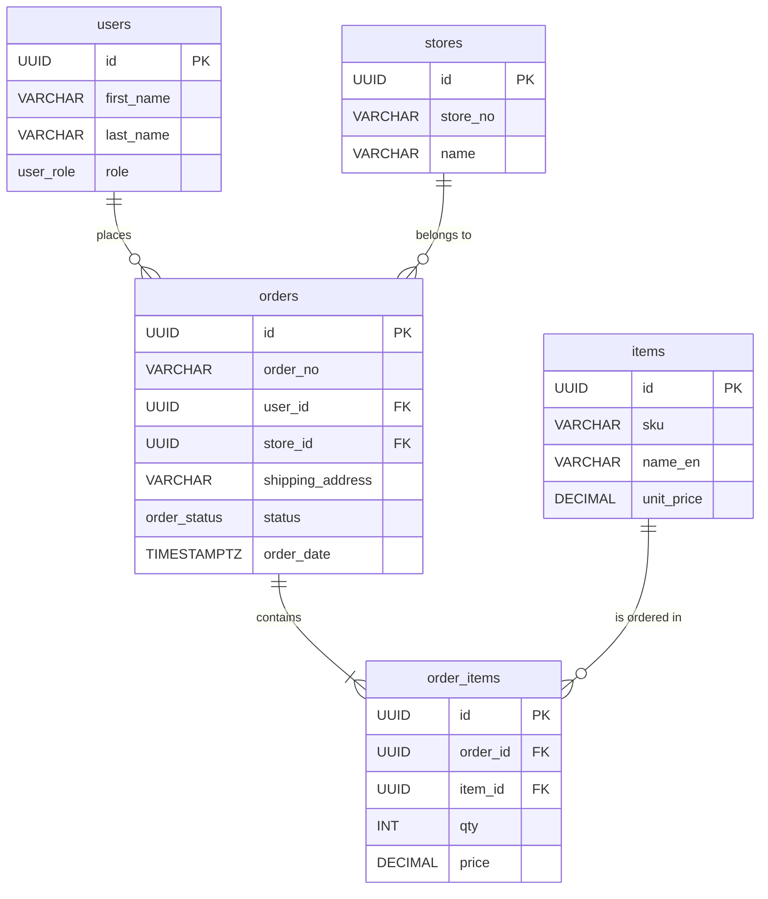

# Order Data Structure (Supabase)

본 문서는 WMS/OrderApp 프로젝트에서 주문 처리를 위해 사용되는 Supabase 데이터베이스 테이블 및 관계 구조를 정의합니다.

## 1. Entity Relationship Diagram (ERD)

## 2. Table Specifications

### 2.1 Enum Types
- **`order_status`**: 주문의 전체 진행 상태를 나타냅니다.
  - `PENDING`: 접수 대기 중
  - `RECEIVED`: 주문 접수됨
  - `ALLOCATED`: 재고 할당 완료
  - `PICKING`: 피킹 진행 중
  - `PICKED`: 피킹 완료
  - `DISPATCHED`: 출고(배송) 완료
  - `CANCELED`: 취소됨

### 2.2 `orders` 테이블 (주문 마스터/헤더)
단일 주문 건에 대한 통합 정보를 관리하는 마스터 테이블입니다.

| Column | Type | Constraints | Description |
|---|---|---|---|
| `id` | UUID | PRIMARY KEY, DEFAULT `gen_random_uuid()` | 주문 고유 ID |
| `order_no` | VARCHAR(50) | UNIQUE, NOT NULL | 주문 번호 (예: `ORD-20260908-001`) |
| `user_id` | UUID | REFERENCES `users(id)` | 주문을 생성한 사용자 ID |
| `store_id` | UUID | NOT NULL, REFERENCES `stores(id)` | 주문이 발생한 매장(Client) ID |
| `shipping_address`| TEXT | | 배송지 주소 |
| `billing_address` | TEXT | | 청구지 주소 |
| `requested_delivery_date` | DATE | | 희망 배송일 |
| `shipping_method` | VARCHAR(100) | | 배송 방법 |
| `tax_amount` | DECIMAL(10, 2) | DEFAULT 0 | 총 부과 세금 |
| `discount_amount` | DECIMAL(10, 2) | DEFAULT 0 | 총 할인액 |
| `status` | `order_status`| NOT NULL, DEFAULT `PENDING` | 주문 상태 |
| `order_date` | TIMESTAMPTZ | DEFAULT `NOW()` | 주문 발생 일시 |
| `note` | TEXT | | 특이사항/메모 |
| `created_at` | TIMESTAMPTZ | DEFAULT `NOW()` | 레코드 생성 일시 |
| `updated_at` | TIMESTAMPTZ | DEFAULT `NOW()` | 레코드 수정 일시 |

### 2.3 `order_items` 테이블 (주문 상세)
하나의 주문(`order_id`) 안에 포함된 개별 상품(`item_id`) 내역을 저장하는 테이블입니다.

| Column | Type | Constraints | Description |
|---|---|---|---|
| `id` | UUID | PRIMARY KEY, DEFAULT `gen_random_uuid()` | 주문 항목 고유 ID |
| `order_id` | UUID | NOT NULL, REFERENCES `orders(id)` ON DELETE CASCADE | 상위 주문 ID |
| `item_id` | UUID | NOT NULL, REFERENCES `items(id)` | 주문된 상품 ID |
| `qty` | INT | NOT NULL, CHECK (`qty > 0`) | 주문 수량 |
| `uom` | VARCHAR(20) | NOT NULL | 기본 단위 (Unit of Measure) |
| `requested_uom` | VARCHAR(20) | | 고객이 요청한 단위 |
| `price` | DECIMAL(10, 2) | NOT NULL | **주문 당시**의 단가 (아이템 가격 변동 대비 스냅샷) |
| `discount_rate` | DECIMAL(5, 2) | DEFAULT 0 | 개별 항목 할인율 |
| `is_taxable` | BOOLEAN | DEFAULT TRUE | 과세 대상 여부 |
| `created_at` | TIMESTAMPTZ | DEFAULT `NOW()` | 레코드 생성 일시 |
| `updated_at` | TIMESTAMPTZ | DEFAULT `NOW()` | 레코드 수정 일시 |

## 3. 접근 제어 정책 (Row Level Security - RLS)

보안 강화를 위해 Supabase의 RLS가 적용되어 있으며, 각 역할(`role`)에 따라 접근 범위가 다릅니다.

### `orders` 정책
- **일반 매장(STORE) 권한**: 본인이 속한(`user_id = auth.uid()`) 주문 건만 조회 가능.
- **관리자 및 현장 작업자(ADMIN, PICKER, INSPECTOR)**: 전체 주문 건 조회 가능.

### `order_items` 정책
- 상위 `orders` 테이블의 조회 권한과 동일하게 적용됩니다. 상위 주문 마스터 데이터에 접근 가능한 사용자만 하위 주문 상세 내역을 볼 수 있습니다.

## 4. 데이터 생성(INSERT) 시 주의사항 및 제약조건

단순히 테이블 구조만 맞춰서 데이터를 넣으려 할 경우, 여러 가지 오류가 발생할 수 있습니다. 다른 앱이나 클라이언트에서 주문 데이터를 생성할 때 **반드시 다음 3가지 주의사항을 고려해야 합니다.**

### 4.1. RLS(Row Level Security)로 인한 `INSERT` 권한 차단
현재 `orders`와 `order_items` 테이블에는 **조회(`SELECT`) 정책만 부여되어 있고 생성(`INSERT`) 정책은 없습니다.**
따라서 일반 사용자 세션으로 브라우저(클라이언트)에서 직접 `supabase.from('orders').insert()`를 호출하면 **권한 오류(403)**가 발생합니다.
- **해결책**: 클라이언트에서 직접 접근하지 말고, 반드시 **Next.js Server Action 또는 서버 API**로 데이터를 전달해야 합니다. 서버 측에서 `Service Role Key` (RLS를 우회하는 어드민 키)를 사용하여 Supabase 클라이언트를 초기화한 뒤 데이터를 저장해야 프로젝트 아키텍처 원칙(ADR)을 준수할 수 있습니다.

### 4.2. 트랜잭션(Transaction) 보장 문제
Javascript SDK(Supabase Client)는 단일 트랜잭션을 묶는 기능을 기본 제공하지 않습니다. 
주문 생성 로직은 다음과 같이 논리적으로 동시에 기록되어야 합니다.
1. `orders` 테이블에 새로운 주문 `INSERT` 후 `orders.id` 반환
2. 반환받은 `order_id`를 각 아이템에 매핑하여 `order_items`에 일괄(Bulk) `INSERT`
- **문제점**: 1번은 성공했는데 2번에서 네트워크 에러가 발생하면 "고아(Orphan) 데이터"가 생성됩니다.
- **해결책**:
  1. **앱단 롤백**: `order_items` 저장이 실패할 경우 발급된 `orders.id`를 다시 삭제(Delete)하는 방어 로직을 작성합니다.
  2. **RPC 사용(권장)**: 완벽한 트랜잭션을 위해 Supabase 데이터베이스 내부에 `create_order`라는 **PostgreSQL RPC(Function)**를 생성하고, 앱에서는 해당 RPC 함수 하나만 호출하는 방식으로 구현하는 것이 가장 안전합니다.

### 4.3. 필수(NOT NULL) 제약조건 및 무결성 검증
데이터를 삽입할 때 다음 컬럼들이 누락되거나 유효하지 않으면 500 오류가 발생합니다.
- **`order_no` (주문번호)**: 중복 불가능한 값(Unique). 앱 단에서 확실한 채번 로직(예: `ORD-YYYYMMDD-랜덤문자`)을 구현해서 전달해야 합니다.
- **`store_id` (매장 ID)**: `stores` 테이블에 실제로 존재하는 매장 ID여야 Foreign Key 제약을 통과합니다.
- **`price` (주문 단가)**: 주문 발생 시점의 단가를 `order_items` 테이블의 `price`에 반드시 캡처해서 넣어주어야 합니다 (상품 가격 변동 대비 필수).
- 기타 `user_id`, `uom`, `qty` 등 스키마에 정의된 NOT NULL 필드를 확인하세요.
